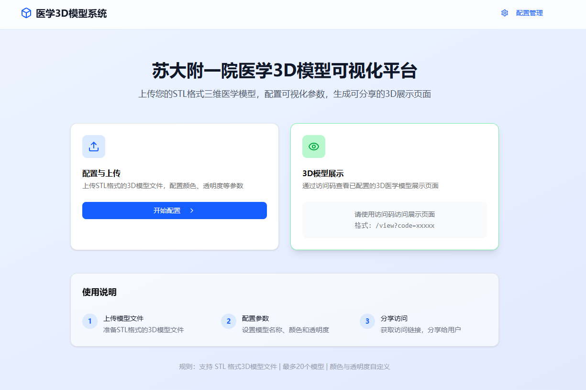
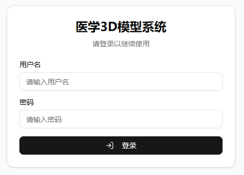
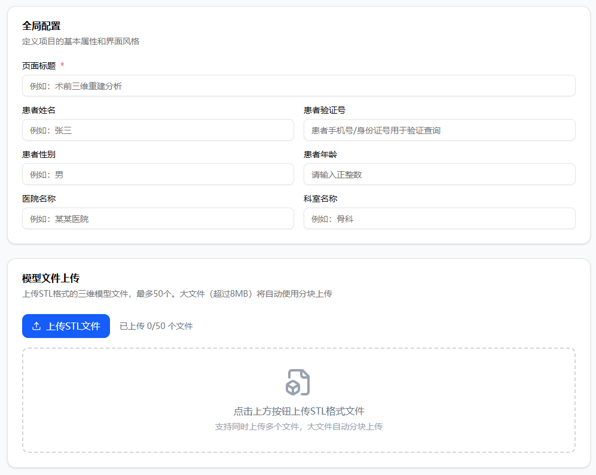
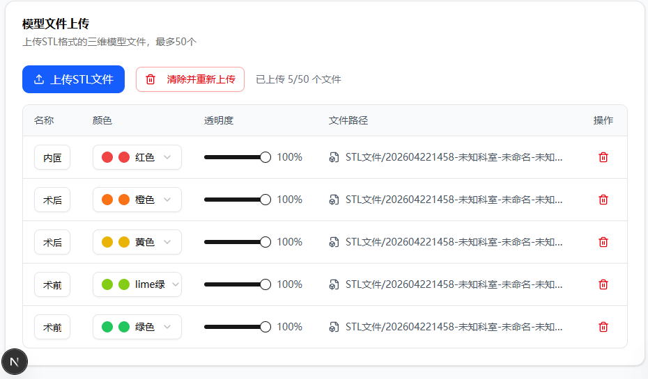
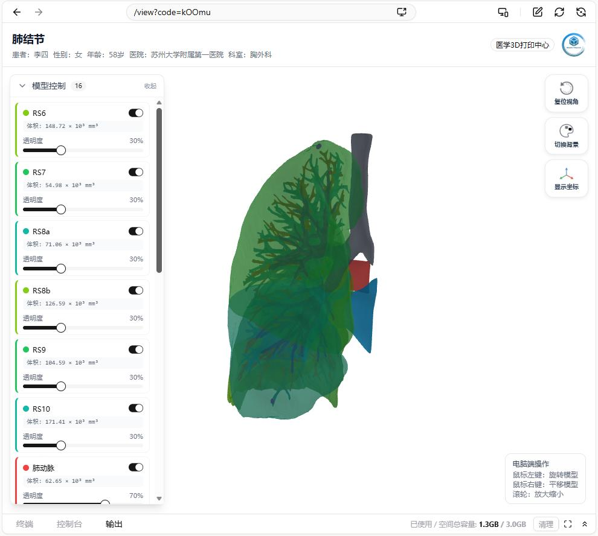
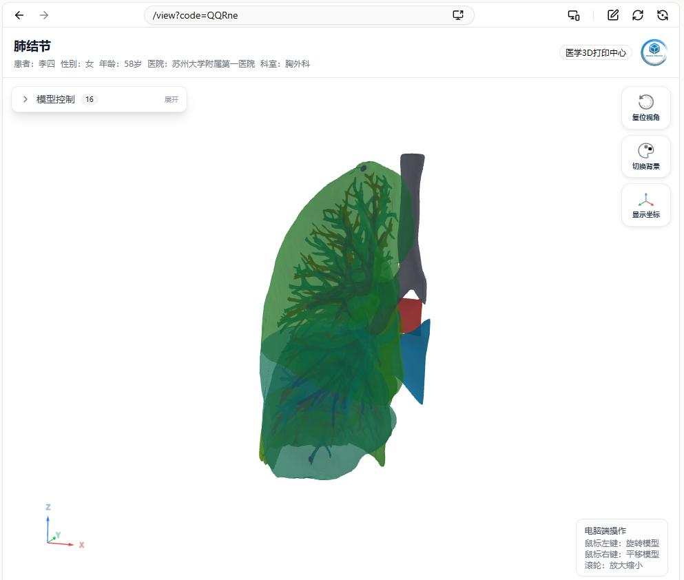
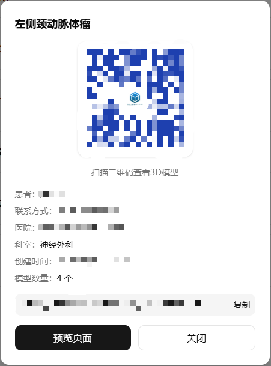
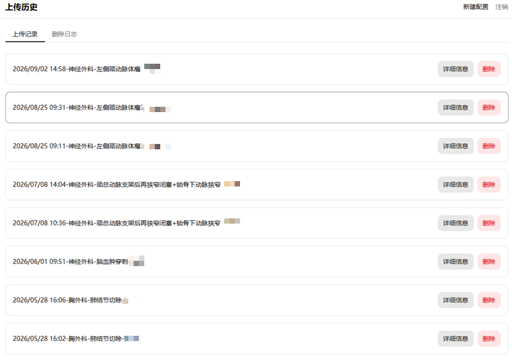

# 医学三维重建可视化平台 V2.0

面向医疗机构医学 3D 打印中心的三维模型可视化平台。采用浏览器/服务器（B/S）架构，医生通过网页即可完成医学三维重建 STL 模型的**上传、管理与在线查看**；患者**无需安装任何客户端**，凭访问码即可在浏览器中查看自己的三维模型。平台为术前会诊、手术规划与医患沟通提供便捷的三维可视化手段。



> 苏州大学附属第一医院 医学3D打印中心

---

## 目录

- [一、软件概述](#一软件概述)
- [二、系统登录](#二系统登录)
- [三、首页与模型列表](#三首页与模型列表)
- [四、模型上传管理](#四模型上传管理)
- [五、三维模型查看](#五三维模型查看)
- [六、患者验证与二维码分享](#六患者验证与二维码分享)
- [七、历史记录](#七历史记录)
- [八、用户管理](#八用户管理)
- [技术架构](#技术架构)
- [3D 渲染技术细节](#3d-渲染技术细节)
- [数据库表结构](#数据库表结构)
- [环境变量配置](#环境变量配置)
- [本地开发与部署](#本地开发与部署)

---

## 一、软件概述

### 1.1 软件名称与版本

| 项目 | 内容 |
|------|------|
| 软件全称 | 医学三维重建可视化平台 |
| 版本号 | V2.0 |

### 1.2 软件用途

本软件是一款面向医疗机构医学 3D 打印中心的三维模型可视化平台，采用浏览器/服务器（B/S）架构。医生通过网页即可完成医学三维重建 STL 模型的上传、管理与在线查看；患者无需安装任何客户端，凭访问码即可在浏览器中查看自己的三维模型。平台为术前会诊、手术规划与医患沟通提供了便捷的三维可视化手段。

### 1.3 运行环境

| 项目 | 说明 |
|------|------|
| 服务器操作系统 | Linux（Ubuntu 22.04） |
| 客户端 | Chrome、Edge、Firefox、Safari 等现代浏览器（需支持 WebGL） |
| 运行支撑环境 | Node.js 22 运行环境、SQLite 数据库 |
| 技术框架 | Next.js 16 + React 19 + TypeScript + Three.js |

---

## 二、系统登录

本软件采用账号密码登录方式，医生使用管理员分配的账号登录系统后方可使用模型上传、管理等业务功能。登录模块采用基于 JWT 的身份认证机制，密码以加密方式存储，保障账号安全。

**操作步骤**

1. 在浏览器中打开系统地址，进入登录页面；
2. 输入医生账号与密码；
3. 点击「登录」按钮，系统校验通过后进入首页。



**安全机制**：登录接口设有防暴力破解的频率限制（基于 IP 的滑动窗口算法，默认 60 秒内最多 5 次尝试，超限返回 HTTP 429），管理后台支持 IP 白名单访问控制。

---

## 三、首页与模型列表

登录成功后进入系统首页，首页展示平台的模型列表信息。医生可在此浏览已上传的三维模型记录，查看模型对应的患者、科室、上传时间等元数据，并可通过列表入口进入模型详情或上传新的模型。

首页提供两个功能入口：

- **配置与上传**：进入模型上传管理页，配置颜色、透明度等参数；
- **3D 模型展示**：通过访问码访问已配置的三维医学模型展示页面（格式 `/view?code=xxxxxxxx`）。

页面底部附三步使用说明：上传模型文件 → 配置参数 → 分享访问。


---

## 四、模型上传管理

医生登录后进入上传管理页面，可上传医学三维重建生成的 STL 格式模型文件，并对上传的模型进行分组、命名、删除等管理操作。系统按文件夹分组处理上传，自动为文件生成带时间戳的目录前缀以隔离不同批次的数据，同时支持大文件的分片上传，保障上传的稳定性。

**操作步骤**

1. 进入「上传管理」页面，填写页面标题、患者姓名、性别、年龄、医院、科室等元数据；
2. 选择本地的 STL 模型文件进行上传，系统自动进行格式校验；
3. 上传完成后，可为每个模型配置名称、渲染颜色、透明度及显示状态；
4. 提交后系统将模型元数据写入数据库，并生成可供分享的展示链接。

### 全局配置



### 模型文件管理

支持多文件批量上传（最多 50 个模型），超过 8MB 的文件自动切换为分块上传（5MB/块），并实时显示上传进度。每个模型可独立配置名称、渲染颜色与透明度。



---

## 五、三维模型查看

通过访问码或分享链接进入三维展示页面，系统基于 WebGL 技术在三维画布中渲染全部 STL 模型。用户可对模型进行旋转、缩放、平移等交互操作，并可切换多视角观察；系统支持半透明渲染，可清晰展示组织内部结构，同时提供长度、体积等在线测量工具，辅助医生进行术前规划与形态评估。



### 具体功能与操作

进入三维展示页面后，界面提供以下主要功能与对应操作：

| # | 功能 | 操作说明 |
|:--:|------|---------|
| 1 | **视图交互操作** | 鼠标左键拖拽旋转模型、滚轮缩放、右键拖拽平移，实现任意角度观察 |
| 2 | **模型显示控制** | 通过控制面板逐个切换各模型的显示与隐藏，并独立调节每个模型的渲染颜色与透明度，便于突出关注部位 |
| 3 | **复位** | 点击「复位视角」，模型恢复到加载完成时的最佳观察视角，同时重置旋转、缩放与平移状态 |
| 4 | **切换背景** | 点击「切换背景」，可在黑、灰、白三档背景色之间循环切换，适配不同观察环境 |
| 5 | **渲染模式切换（经典/电影）** | 经典模式采用 Lambert 风格与高亮方向光，适合一般浏览；电影模式启用色调映射、IBL 环境光、SSAO 环境光遮蔽与物理材质，适合展示精细立体效果 |
| 6 | **测距** | 点击「划线测距」进入测距模式，在模型上依次点击两点即可画出线段并显示距离（单位 cm），再次点击该按钮或按 Esc 退出 |
| 7 | **旋转展示** | 点击「旋转展示」，模型绕当前视角垂直轴自动旋转，便于整体浏览三维形态；再次点击停止旋转 |

系统同时自动计算并展示每个模型的**体积（mL）**与**外包围尺寸（cm）**。



---

## 六、患者验证与二维码分享

医生可为每位患者生成唯一的访问码与二维码，患者凭访问码即可在线查看自己的三维模型，无需安装任何软件。系统对患者验证接口设有防暴力破解的限流机制，保障患者数据安全。

**操作步骤**

1. 医生在模型详情中生成访问码与二维码；
2. 患者扫描二维码或在浏览器打开展示页面；
3. 系统校验通过后，患者进入三维模型查看页面。



> 访问码为 8 位随机字符，具备足够大的枚举空间，配合限流机制有效防止暴力遍历。

---

## 七、历史记录

系统自动记录医生的上传与操作历史，便于回溯和追溯。医生可在历史记录页面按时间浏览自己的操作记录，掌握模型的上传、查看等使用情况。

页面包含「上传记录」与「删除日志」两个视图：上传记录支持查看详细信息（二维码、访问链接、患者信息）与删除；删除日志完整记录每一次删除操作的配置信息、被删除文件列表与操作时间，只读不可修改。



---

## 八、用户管理

系统管理员可进入用户管理页面，对医生账号进行新增、编辑、删除、停用等管理操作，并可查看系统操作日志，实现平台的统一运维管理。普通医生账号不具备用户管理权限。

**操作步骤**

1. 管理员登录后进入「用户管理」页面；
2. 新增医生账号，或对已有账号进行编辑、停用、删除；
3. 查看系统操作日志，掌握平台运行情况。

---

## 技术架构

| 层次 | 技术 |
|------|------|
| 前端框架 | Next.js 16 (App Router) + React 19 |
| 语言 | TypeScript 5 |
| 3D 渲染 | Three.js（TrackballControls、STLLoader、EffectComposer、SSAO、SMAA、WBOIT） |
| UI 组件 | shadcn/ui (Radix UI) |
| 样式 | Tailwind CSS 4 |
| 数据库 | SQLite（better-sqlite3，本地文件 `data/medical3d.db`） |
| 认证 | JWT Cookie (jose) + token_version 撤销机制 |
| 密码加密 | bcrypt |
| 二维码 | qr-code-styling |
| 文件存储 | 本地文件系统 `public/uploads/` |

### 角色与权限

| 角色 | 权限 |
|------|------|
| **医生 (doctor)** | 上传模型、配置参数、生成展示页面、查看/删除自己的历史记录 |
| **管理员 (admin)** | 拥有医生全部权限，额外可管理用户账号、查看所有医生的操作日志 |
| **患者（无账号）** | 凭访问码查看自己的模型，无需注册登录 |

### 安全设计

- **JWT Cookie 认证**：基于 jose 库实现，含 `token_version` 机制，登出后旧 Token 立即失效
- **密码加密**：bcrypt 哈希存储，登录验证采用定时安全比较防止时序攻击
- **权限控制**：患者/上传等 API 均校验登录状态与角色权限
- **文件访问防护**：路径白名单 + `path.resolve` 前缀校验，杜绝路径遍历
- **频率限制**：登录与患者验证接口均设限流
- **操作审计**：所有删除操作写入 `delete_logs` 表，界面只读

---

## 3D 渲染技术细节

### 渲染管线架构

```
经典渲染模式：
  Opaque Pass (MSAA 4x) → 直接输出

电影渲染模式：
  Opaque Pass → EffectComposer → RenderPass → SSAOPass → SMAAPass → OutputPass (ACES)
  Transparent Pass → WBOIT Accumulation/Revealage → Composite (含 ACES)
  → 最终合成
```

### WBOIT（加权混合顺序无关透明）

采用 McGuire 2013 年的 WBOIT 算法实现正确的透明渲染：

- **Pass 1**：不透明物体渲染（支持 EffectComposer 后处理管线）
- **Pass 2**：透明物体 WBOIT 累积/揭示渲染
- **Pass 3**：全屏四边形合成

### 电影渲染特性

- **ACES Filmic 色调映射**：防止高光过曝，自然色彩压缩
- **IBL 环境光照**：基于 RoomEnvironment + PMREMGenerator 生成虚拟摄影棚环境图
- **三点照明**：主光 + 补光 + 轮廓光，跟随摄像机旋转
- **MeshPhysicalMaterial + Fake SSS**：通过 transmission/thickness/ior/clearcoat 模拟次表面散射
- **SSAO 环境遮蔽**：增强模型细节的深度感
- **SMAA 抗锯齿**：后处理抗锯齿 + MSAA 渲染目标

### 旋转展示算法

- **旋转中心**：模型几何中心（`controls.target`）
- **旋转轴**：相机局部 Y 轴（当前视角的垂直向上方向）
- **旋转速度**：每帧 0.008 弧度（约 13 秒一圈）
- **交互处理**：旋转时禁用手动控制，停止时无缝切换回 TrackballControls

### 几何数据健壮性

STL 文件可能包含无效顶点（NaN/Infinity），平台在解析后立即执行几何清理：

- `sanitizeGeometry()`：逐三角形检查，过滤含无效顶点的三角形，同步重建 position 与 normal 属性
- `calculateVolume()`：双重保护，跳过含无效值的三角形，确保体积计算结果可靠

### 29 种专业医学颜色

基于 3DSlicer 组织/器官颜色表：

| 颜色键 | 组织/器官 | 色值 | | 颜色键 | 组织/器官 | 色值 |
|--------|----------|------|-|--------|----------|------|
| tissue | 常规软组织 | #80AE80 | | gray_matter | 脑灰质 | #C8C8EB |
| bone | 骨骼 | #F1D691 | | white_matter | 脑白质 | #FAFAD2 |
| skin | 皮肤 | #B17A65 | | nerve | 神经 | #F4D631 |
| connective_tissue | 结缔组织 | #6FB8D2 | | vein | 静脉 | #0097CE |
| blood | 血液 | #D8654F | | artery | 动脉 | #D8654F |
| organ | 一般器官 | #DD8265 | | ligament | 韧带 | #B7D6D3 |
| mass | 肿块/病灶 | #90EE90 | | tendon | 肌腱 | #98BDCF |
| muscle | 肌肉 | #C06858 | | cartilage | 软骨 | #6FB8D2 |
| foreign_object | 异物(植入物) | #DCF514 | | lymph_node | 淋巴结 | #44AC64 |
| teeth | 牙齿 | #FFFADC | | lymphatic_vessel | 淋巴管 | #6FC583 |
| fat | 脂肪 | #E6DC46 | | cerebrospinal_fluid | 脑脊液 | #55BCFF |
| bile | 胆汁 | #00911E | | fluid | 一般体液 | #AAFAFA |
| edema | 水肿区 | #8CE0E4 | | bleeding | 出血区 | #BC411C |
| necrosis | 坏死区 | #D8BFD8 | | target_volume | 靶区 | #FFFF00 |
| airway | 支气管/气道 | #AFD8F4 | | | | |

---

## 数据库表结构

### users（用户表）

| 字段 | 类型 | 说明 |
|------|------|------|
| id | INTEGER | 主键 |
| username | TEXT | 用户名（唯一） |
| password_hash | TEXT | bcrypt 哈希密码 |
| role | TEXT | 角色：admin/doctor |
| status | TEXT | 状态：active/disabled |
| token_version | INTEGER | Token 版本（登出/改密时递增，用于撤销旧 Token） |
| created_at / updated_at | TEXT | 创建/更新时间 |

### patients（患者表）

| 字段 | 类型 | 说明 |
|------|------|------|
| id | INTEGER | 主键 |
| name | TEXT | 患者姓名 |
| phone | TEXT | 手机号 |
| created_at | TEXT | 创建时间 |

### medical_configs（模型配置表）

| 字段 | 类型 | 说明 |
|------|------|------|
| id | INTEGER | 主键 |
| code | TEXT | 访问码（8 位随机字符） |
| title | TEXT | 页面标题 |
| patient_id | INTEGER | 关联患者 ID |
| patient_name / patient_phone / patient_gender / patient_age | TEXT/INTEGER | 患者信息 |
| hospital / department | TEXT | 医院 / 科室 |
| creator_id | INTEGER | 创建者用户 ID |
| created_at / updated_at | TEXT | 创建/更新时间 |

### medical_models（模型表）

| 字段 | 类型 | 说明 |
|------|------|------|
| id | INTEGER | 主键 |
| config_id | INTEGER | 关联配置 ID |
| name | TEXT | 模型名称 |
| color | TEXT | 渲染颜色 |
| opacity | INTEGER | 透明度（0-100） |
| file_path | TEXT | STL 文件路径 |
| visible | INTEGER | 是否可见 |
| sort_order | INTEGER | 排序 |
| created_at | TEXT | 创建时间 |

### delete_logs（删除日志表）

| 字段 | 类型 | 说明 |
|------|------|------|
| id | INTEGER | 主键 |
| operator_id / operator_name | INTEGER/TEXT | 操作人 |
| config_id / config_code / config_title | INTEGER/TEXT | 被删除的配置信息 |
| patient_name / hospital / department | TEXT | 患者与科室信息 |
| model_count | INTEGER | 模型数量 |
| deleted_files | TEXT | 被删除的文件路径列表 |
| deleted_at | TEXT | 删除时间 |

---

## 环境变量配置

复制 `.env.example` 为 `.env` 并填写：

```env
# 运行环境
NODE_ENV=production
PORT=5000
HOSTNAME=0.0.0.0
NEXT_PUBLIC_SITE_URL=https://your-domain.com

# JWT 密钥（必填，至少 32 位随机字符串）
# 生成方式：openssl rand -hex 32
JWT_SECRET=<请填写随机密钥>

# 初始管理员账号（首次启动时自动创建）
ADMIN_USERNAME=<管理员用户名>
ADMIN_PASSWORD=<请设置强密码>

# 初始医生账号（可选，格式：用户名:密码:角色，多个用逗号分隔）
INITIAL_USERS=<用户名>:<密码>:doctor

# 管理后台 IP 白名单（可选，逗号分隔，支持 CIDR）
ADMIN_IP_WHITELIST=127.0.0.1,192.168.1.0/24

# 登录频率限制（可选，格式：次数/秒数，默认 5/60）
LOGIN_RATE_LIMIT=5/60

# SQLite 数据库路径（可选，默认 data/medical3d.db）
SQLITE_PATH=data/medical3d.db
```

> **安全提示**：请勿将填有真实密钥与密码的 `.env` 提交到版本库（`.gitignore` 已排除）。

---

## 本地开发与部署

### 环境要求

- **Node.js 22**（better-sqlite3 依赖对应版本的预编译二进制，建议使用 Node 22 LTS）
- pnpm 9
- Windows / Linux / macOS

### 本地开发

```bash
pnpm install
pnpm dev
```

启动后访问 `http://localhost:5000`。

### 生产构建

```bash
pnpm install
pnpm build
pnpm start
```

### 云服务器部署

项目提供一键部署脚本 `deploy.sh` 与完整部署文档 `DEPLOY.md`，覆盖服务器选购、环境安装、域名备案、HTTPS 配置、公众号接入与数据备份全流程：

```bash
bash deploy.sh
```

脚本将自动完成：安装 Node.js 22 + pnpm 9 + PM2、生成随机 JWT 密钥与管理员密码、构建项目、以 PM2 守护进程启动并配置开机自启。

### 数据备份

SQLite 数据库为单文件，备份即复制 `data/medical3d.db`；上传的 STL 文件位于 `public/uploads/`，一并备份即可。

---

## 页面导航关系

```
首页 (/)
├── 登录 (/login)
│   ├── 医生 → 上传页 (/upload)
│   │   └── 提交成功 → 历史记录 (/history)
│   └── 管理员 → 用户管理 (/admin/users)
├── 患者验证 (/verify)
│   └── 模型列表 (/list?patient_id=xxx)
│       └── 3D展示 (/view?code=xxx)
└── 3D展示 (/view?code=xxx) ← 直接通过访问码/二维码访问
```

---

<sub>苏州大学附属第一医院 医学3D打印中心</sub>
